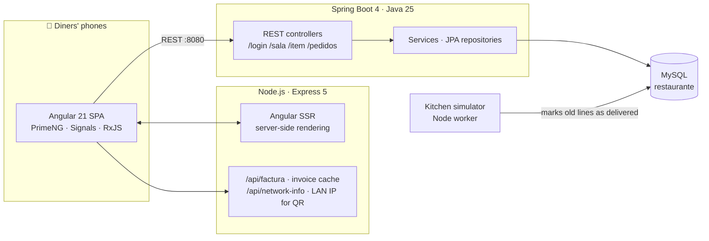
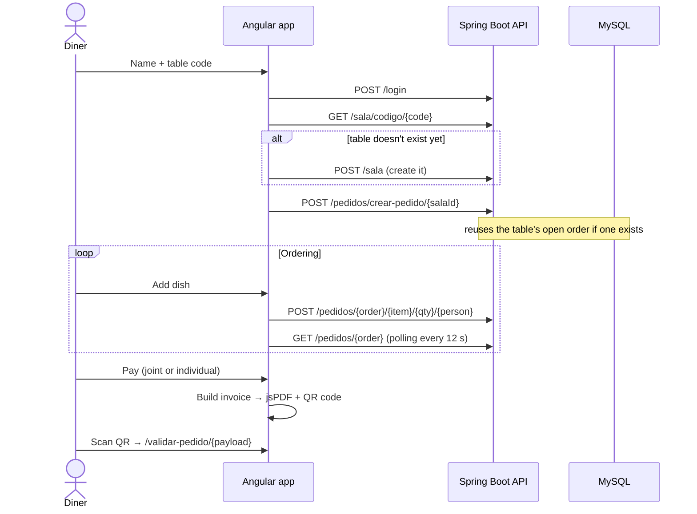

<div align="center">

# 🍽️ Restaurant Group Ordering — Final Degree Project (TFG)

**Order from your phone with everyone at the table: join a shared table by code, build a group order in real time, split the bill per person and get a PDF invoice with a verifiable QR code.**


</div>

<!-- Add screenshots here: join screen · menu · shared cart · split bill · PDF invoice -->

---

## The problem

At a table of six, ordering is slow and paying is worse: one waiter, one bill, and five people doing maths on their phones. This app moves both steps to the diners' own phones:

1. **Join the table** with your name and the table code.
2. **Order from the menu**: everyone adds dishes to the same shared order, and each line remembers who ordered it.
3. **Watch the shared cart update** as the kitchen serves items.
4. **Pay together or individually**: the bill is split automatically per person.
5. **Get a PDF invoice and a QR code** that anyone can scan to verify the bill.

## Architecture



## User flow



## Engineering highlights

### Shared ordering (backend)
- **One open order per table.** `obtenerOCrearPedidoPendiente` returns the table's unfinished order or creates it, so several diners joining at once end up in the same order.
- **Line merging.** Adding a dish someone already has pending **merges quantities into one line** (per item and per person) and removes duplicates, keeping the order clean.
- **Order lifecycle.** Lines are marked delivered as they're served; when nothing is pending, the order closes automatically.
- **REST API in Spring Boot 4** with Spring Data JPA derived queries (`findByIdPedidoAndIdItemAndEntregadoAndIdPersona`, `findFirstByIdSalaAndFinalizadoFalse`).

### Real-time feel (frontend)
- **Live shared cart** via an RxJS `timer` polling every 12 seconds, cleaned up automatically with `takeUntilDestroyed`.
- **Menu grouped by course** (drinks, first, second, dessert) with 27 product images.
- **Angular 21**: standalone components, Signals, `inject()`, `OnPush` change detection, SSR with hydration.

### Payments and invoices
- **Joint or individual payment**: the invoice is aggregated per person (items, quantity, subtotal) so each diner pays only for what they ordered.
- **PDF invoices generated client-side** with jsPDF.
- **Self-contained QR invoices**: the invoice is serialised to a compact JSON (short keys, line arrays), Base64-URL encoded and placed in the QR code. Scanning it opens `/validar-pedido/...`, which decodes and displays the bill **without a database lookup**. Each invoice carries a 192-bit random token generated with the Web Crypto API, so codes can't be guessed.
- **QR reachable from other phones**: the Express server exposes `/api/network-info` with the machine's LAN IP, so the QR points to an address other devices on the Wi-Fi can open.

### Kitchen simulator
`backend/comprobarPedidosPendientes.js` is a Node worker that, every 30 s, marks order lines older than N minutes as delivered, simulating the kitchen. It validates the table schema on startup, runs each check **inside a transaction with rollback**, avoids overlapping runs with a guard flag, and shuts down cleanly on `SIGINT` / `SIGTERM`. All settings come from environment variables.

## Quick start

**Requirements:** Node.js 20+, Java 25, Maven (or the included `mvnw`), MySQL 8.

```bash
# 1. Database
mysql -u root -p -e "CREATE DATABASE restaurante"

# 2. Backend API -> http://localhost:8080  (JPA creates the tables on first run)
cd backend/demo
./mvnw spring-boot:run

# 3. Frontend -> http://localhost:4200
cd ../..
npm install
npm start

# 4. (Optional) kitchen simulator
cd backend && npm install mysql2 && DB_PASSWORD=... node comprobarPedidosPendientes.js
```

Set your MySQL password in `backend/demo/src/main/resources/application.properties` (or via the `SPRING_DATASOURCE_PASSWORD` environment variable). For the SSR build: `npm run build` then `npm run serve:ssr:TFGangular`.

## Project structure

```text
├── src/
│   ├── app/
│   │   ├── formulario/       # Join or create a table
│   │   ├── menu/             # Menu grouped by course
│   │   ├── carrito/          # Shared cart (live polling)
│   │   ├── pago/             # Joint / individual bill, PDF, QR
│   │   ├── pasarela-pago/    # Payment step
│   │   ├── validar-pedido/   # Decode and verify a QR invoice
│   │   └── services/         # API URL, payments, PDF invoices, shared state
│   └── server.ts             # Express 5 + Angular SSR + invoice endpoints
├── public/img/               # Dish images
├── backend/
│   ├── demo/                 # Spring Boot 4 REST API
│   └── comprobarPedidosPendientes.js   # Kitchen simulator
└── *.pptx                    # TFG presentation
```

## Tech stack

| Layer | Tools |
|---|---|
| Frontend | Angular 21 (SSR, Signals, standalone), TypeScript, PrimeNG, RxJS |
| Documents | jsPDF (invoices), qrcode (QR generation) |
| SSR server | Node.js, Express 5 |
| Backend | Java 25, Spring Boot 4, Spring Data JPA, Lombok |
| Database | MySQL |

## Next steps

- Replace polling with WebSockets / Server-Sent Events for instant cart updates
- Real payment integration (Stripe test mode) and signed QR payloads
- Kitchen dashboard for staff instead of the simulator

---

<div align="center">

Final Degree Project (TFG) by **Marcos** · [@mmartinezvaras](https://github.com/mmartinezvaras)

</div>
